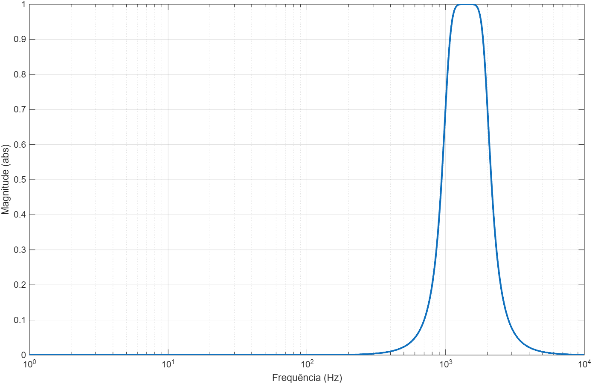

# Signal Processing

MATLAB and Simulink coursework exploring signal generation, sampling, Fourier analysis, convolution, and analog and digital filter design. Developed during Computer Engineering studies at **Universidade Tecnológica Federal do Paraná (UTFPR)**.

The repository brings together topic-based labs and two group assessments, including source code, measured data, reports, diagrams, and saved results. Original Portuguese filenames and comments are retained inside the activities.

## Featured projects

| Project | What it explores | Deliverables |
| --- | --- | --- |
| [Convolution, impulse response & rectifier FFT](projects/assessment-01/) | Manual convolution compared with MATLAB filtering, recursive system responses, RMS values, harmonics, and distortion | MATLAB scripts, measurement data, report, and result plots |
| [IIR/FIR filters & fixed-point implementation](projects/assessment-02/) | Butterworth band-pass design, bilinear transformation, direct-form filtering, coefficient quantization, and FIR symmetry | MATLAB scripts, FIR coefficients, block diagrams, report, and result plots |



*A saved result from the original assessment submission; see the project READMEs for implementation details and limitations.*

## Labs by topic

| Topic | Activities |
| --- | --- |
| [01 · MATLAB basics](labs/01-matlab-basics/) | Sine and square waves, helper functions, echo, loops, and Newton's method |
| [02 · Audio convolution](labs/02-audio-convolution/) | Speaker cabinet impulse responses, truncation, resampling, and audio comparison |
| [03 · Fourier series](labs/03-fourier-series/) | Continuous-time pulse reconstruction and a discrete-time exercise template |
| [04 · Frequency response](labs/04-frequency-response/) | Low-pass filtering of test tones and magnitude/phase analysis |
| [05 · Z-transform](labs/05-z-transform/) | Partial fractions, difference equations, step and impulse responses |
| [06 · DFT and FFT](labs/06-dft-fft/) | Explicit DFT calculation, zero padding, FFT timing, and frequency response |
| [07 · Sampling](labs/07-sampling/) | Simulink models for studying sampling effects |
| [08 · Filter approximations](labs/08-filter-approximations/) | Butterworth, Chebyshev I/II, and elliptic analog prototypes |
| [09 · Filter design](labs/09-filter-design/) | Low-pass, high-pass, band-pass, and band-stop design with discretization |

## Repository layout

```text
SignalProcessing/
├── projects/                 # Group assessments: code, reports, results
│   ├── assessment-01/
│   └── assessment-02/
├── labs/                     # Nine topics, each with a local README
├── materials/                # Course guides and assessment statements
└── archive/                  # Original submission ZIPs and a Simulink backup
```

## Running the examples

Open the repository in MATLAB, then set **Current Folder to the directory containing the selected script**. Examples below assume that MATLAB starts at the repository root; return to that root before switching activities.

```matlab
% A first example: generate and plot sine/cosine signals.
cd('labs/01-matlab-basics')
geraSenoide
```

```matlab
% DFT versus FFT, using the impulse response stored beside the script.
cd('labs/06-dft-fft')
DFT_FFT_vs_Resp_Freq
```

For group projects, follow their local READMEs. For sampling, open a `.slx` model from [the sampling folder](labs/07-sampling/). Data files and helper functions stay close to the scripts that use them.

| Requirement | Used by |
| --- | --- |
| MATLAB | All `.m` scripts; basic generation, arithmetic, plotting, and FFT |
| Signal Processing Toolbox | Filter design/analysis, waveform helpers, and resampling |
| Control System Toolbox | Scripts using `tf` for transfer-function representations |
| Symbolic Math Toolbox | `aproximacaoFiltros2.m`, which solves for band-edge frequencies |
| Fixed-Point Designer | Assessment 02, which uses `fi` and `fimath` |
| Simulink | Sampling models; inspect each model's blocks for additional dependencies |
| Audio output | Examples using `sound` or `audioplayer` |

Some scripts use `Name=Value` syntax; use MATLAB R2021a or later for that syntax. The sampling folder includes models labeled `2024a`; their compatibility with other releases has not been verified.

Run activities separately. Several clear the workspace, close figures, or pause for keyboard input. Avoid adding all folders recursively to the MATLAB path: different activities intentionally contain different versions of `play_audio.m`.

## Scope and status

This is an academic collection. Original code is preserved, including exercise scaffolds and implementation issues described in the local READMEs. Saved figures and reports document the submitted work; they are not results of a new validation run. The reorganization checked file integrity, extracted project contents, and documentation links. MATLAB scripts and Simulink simulations have not been rerun as part of this update.

## Contributors and course material

Repository maintained by **Pedro Augusto Merisio**. The two group assessments were developed with **Amarildo Piovesan Jr.** and **Erik Takahiro Suzuki**.

[Course guides and assignment statements](materials/) are supporting teaching material, distinct from group submissions. Audio samples and speaker cabinet impulse responses are included as original lab inputs; their presence does not imply authorship by the contributors. [Original submission archives](archive/) remain available for reference.

No repository-wide license has been added: this collection contains coursework and supplied resources with different origins.
