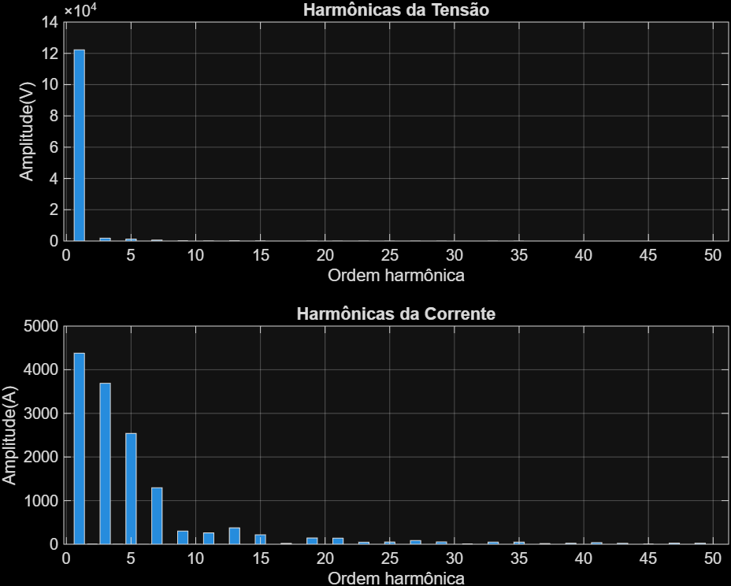

# Assessment 01 · Convolution, impulse response & FFT

[Back to repository](../../README.md)

Group assessment by **Amarildo Piovesan Jr., Erik Takahiro Suzuki, and Pedro Augusto Merisio**. It combines audio convolution, recursive filter analysis, and FFT analysis of measured rectifier voltage/current signals.

## Source and workflow

| Activity | Entry point | What the code does |
| --- | --- | --- |
| Audio convolution | [Exercicio_1.m](code/ex01-audio-convolution/Exercicio_1.m) | Converts input audio to mono, normalizes it, resamples/truncates a cabinet impulse response, and compares custom convolution with `filter` |
| Recursive impulse response | [Exercicio_2.m](code/ex02-impulse-response/Exercicio_2.m) | Implements a first-order difference equation for a unit impulse |
| Analytical comparison | [Exercicio_3.m](code/ex03-response-verification/Exercicio_3.m) | Computes recursive and analytical responses and displays their signed difference sum |
| Rectifier analysis | [Retificador_FFT.m](code/ex05-rectifier-fft/Retificador_FFT.m) | Loads voltage/current measurements and calculates RMS, harmonic spectra, relative harmonic amplitudes, and distortion |

The audio activity includes [myconv.m](code/ex01-audio-convolution/myconv.m), a nested-loop implementation of linear convolution. It compares the initial output samples with MATLAB's `filter`, whose output has the input length. The rectifier activity uses [medidas.mat](code/ex05-rectifier-fft/medidas.mat), with a sampling frequency of 48 kHz and 800 samples per 60 Hz cycle.

## Run

From the repository root in MATLAB:

```matlab
cd('projects/assessment-01/code/ex02-impulse-response')
Exercicio_2
```

To explore the spectra, set Current Folder to `projects/assessment-01/code/ex05-rectifier-fft`, then run `Retificador_FFT`. For audio, use `code/ex01-audio-convolution` and run `Exercicio_1`; the supplied MP3/WAV and helper functions are in that folder. Manual convolution of a full audio recording may take substantial time, and playback pauses are part of the script.

MATLAB is required; the audio resampling uses Signal Processing Toolbox. Audio playback requires an output device.

## Report and saved results

- [Submitted report](reports/report.pdf)
- [Assignment statement](../../materials/assignments/assessment-01.pdf)
- [Statement version included in the submitted ZIP](../../materials/assignments/assessment-01-submitted.pdf)
- [All saved result images](results/)
- [Original submission ZIP](../../archive/submissions/assessment-01.zip)



## Reading the results

The code and figures are preserved from the submission. In `Exercicio_3.m`, the analytical powers use MATLAB's one-based loop index while the plotted sample index starts at zero; review that indexing when comparing responses. The signed sum of errors used in the exercises can cancel positive and negative differences, so it is not a maximum-error measure. The rectifier script applies the limits written in the assignment; its messages should be read as coursework calculations. These routines have not been rerun or corrected during the repository reorganization.
